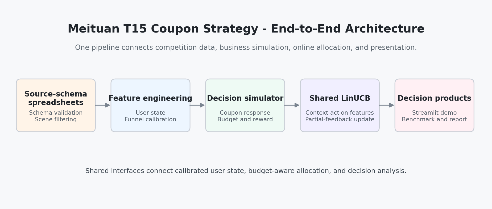
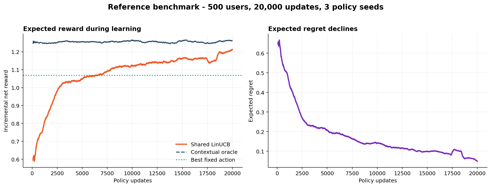
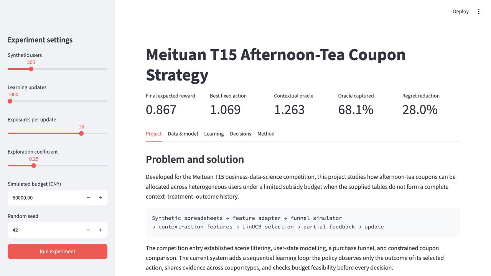

# Meituan T15 Afternoon-Tea Coupon Strategy

An end-to-end Meituan T15 competition solution for allocating afternoon-tea coupons across heterogeneous users under a finite subsidy budget. The repository extends the original entry with a contextual-bandit allocation layer, automated validation, and an interactive Streamlit application.



## What the project does

The system turns three competition-style tables—user profiles, coupon orders, and behaviour sequences—into a sequence of coupon decisions:

1. **Define the scene.** Filter afternoon-tea users and orders by time, merchant category, product category, and order value.
2. **Construct user state.** Estimate basket value, activity, price sensitivity, and funnel probabilities, then generate a reproducible campaign population.
3. **Model coupon response.** Simulate view → click → cart → purchase behaviour for no-coupon and coupon actions.
4. **Allocate sequentially.** Use shared LinUCB to choose a feasible action from user and coupon features, observe the selected action only, and update the policy online.
5. **Evaluate decisions.** Compare the learned policy with random action, the best fixed coupon, and a contextual oracle; track regret, budget use, action mix, and segment behaviour.
6. **Present the result.** Expose the full workflow in a Streamlit application with calibration, learning curves, decision records, and business-readable explanations.

The repository uses deterministic tables with the competition-data schema. Benchmark results come from the documented simulation environment.

## Setup and checks

Use Python 3.10 (the CI version). From the repository root:

```bash
python -m venv .venv
source .venv/bin/activate
python -m pip install -r requirements.txt
python -m unittest discover -s tests -v
```

The demo and Reference benchmark generate their own input tables and need no account or API key.

## Reference result

The committed benchmark uses 500 synthetic campaign users, 20,000 updates, 16 simulated exposures per update, three policy seeds, `alpha=0.25`, and a CNY 120,000 budget.

| Measure | Result |
| --- | ---: |
| Random-action expected reward | 0.5939 |
| Best fixed-action expected reward | 1.0688 |
| Contextual-oracle expected reward | 1.2560 |
| Mean final-window LinUCB reward | 1.2131 |
| Oracle reward captured | 96.12% |
| First-to-final regret reduction | 90.00% |

Within this fixed experiment, the learned contextual policy is approximately 13.5% above the best single action and captures 96.12% of oracle reward on the final-window user stream.



## Interactive demo

The application covers the competition problem, source calibration, funnel and coupon design, policy learning, segment-level allocation, budget use, and project development.



The screenshot shows a 1,000-update demo; the reference benchmark above uses 20,000 updates.

After setup, start the local application:

```bash
streamlit run app.py
```

## Architecture

The code is split by responsibility and joined by `project_pipeline.py`:

| Module | Responsibility |
| --- | --- |
| `feature_engineering.py` | Source-schema loading, scene extraction, funnel calibration, distribution fitting, and user-state generation |
| `simulation_engine.py` | Purchase funnel, coupon response, expected outcomes, and stochastic campaign feedback |
| `contextual_bandit.py` | Context-action representation, shared/disjoint LinUCB, action feasibility, and online update |
| `project_pipeline.py` | One project-level path shared by the dashboard, CLI, benchmark, and integration tests |
| `app.py` | Interactive project presentation and decision inspection |
| `benchmark_contextual_bandit.py` | Reproducible multi-seed reference experiment |
| `build_project_assets.py` | Rebuild the architecture and benchmark figures used in this repository |

The simulator defines the campaign environment, the bandit consumes its interface, and the pipeline runs and validates both as one project.

## Key technical decisions

| Decision | Rationale |
| --- | --- |
| Shared LinUCB with context-action interactions | Independent coupon models cannot use observations collected for another coupon. Sharing parameters addresses this fragmentation; user-coupon interactions retain context-dependent responses. A disjoint implementation remains available for comparison. |
| Selected-action feedback | Only the issued action's sampled purchase outcome updates the learner; optimal-action expectations remain in evaluation. |
| Centered incremental-net reward | The simulator supplies an expected no-coupon baseline for centering the learning target. This baseline is action-independent at a fixed user context and leaves the reward-maximizing action unchanged. |
| Rank-one inverse updates | Sherman–Morrison updates reuse the regression matrix's inverse after each observation; numerical tests check agreement with direct inversion. |
| Budget-aware feasibility | Coupons whose face value exceeds the remaining budget are removed before action selection; realized subsidy cost is deducted only when a purchase occurs. |
| One orchestration path | The dashboard, command-line demo, benchmark, and integration tests call the same project pipeline, reducing the risk that the public demo and reported experiment use different logic. |

## Reproduce the workflow

```bash
# Run a small complete experiment
python run_bandit_demo.py --steps 500 --budget 3000 --seed 42

# Reproduce the three-seed benchmark
python benchmark_contextual_bandit.py

# Rebuild committed figures
python build_project_assets.py
```

`generate_synthetic_demo.py` can also write the public source-schema spreadsheets to a chosen directory. It refuses to overwrite existing files.

`build_project_assets.py` replaces the committed architecture and benchmark figures.

## How the project evolved

- **Competition solution:** the first version defined the afternoon-tea scene, constructed heterogeneous user profiles, calibrated a purchase funnel, compared constrained coupon strategies, and presented the result in a multi-step Streamlit demo.
- **Reproducible experiment:** deterministic fixtures, validation checks, and an automated input-to-decision path made the original analysis repeatable outside the competition environment.
- **Sequential allocation:** the coupon comparison remained as a reference layer, while a shared contextual-bandit policy was added to learn from selected-action feedback under a finite campaign budget.
- **Integrated project:** the application, benchmark, figures, documentation, tests, and continuous integration use one project-level pipeline.

## Documentation

- [Engineering design](docs/ENGINEERING_DESIGN.md): architecture, interfaces, data contracts, testing, and technical decisions.
- [Final technical report](docs/FINAL_REPORT.md): the complete competition problem, modelling workflow, allocation method, results, and subsequent engineering work.

## Evaluation

The benchmark uses the documented semi-synthetic campaign environment because the source tables do not contain randomized coupon assignment or logging propensities. Live experimentation would add controlled exploration, propensity logging, delayed-outcome attribution, budget pacing, and offline policy evaluation.
