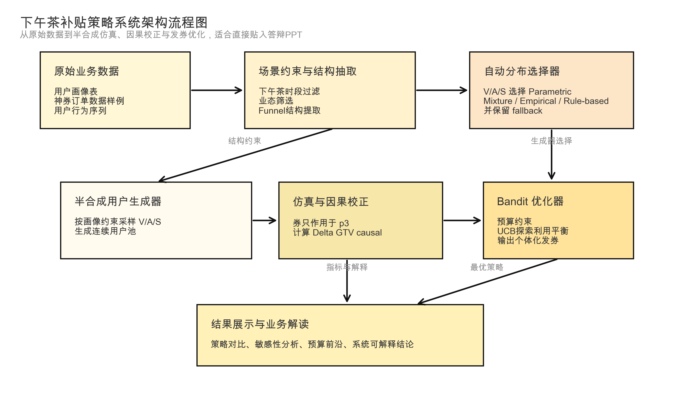

# Afternoon Tea Coupon Allocation Simulator

A semi-synthetic prototype for studying coupon allocation in an afternoon-tea ordering scenario. It uses order data to model customer heterogeneity, a small behavior-sequence sample to define a purchase funnel, and profile data to describe segments. A simulator then compares coupon policies under budget and coverage constraints.

This repository is a **modeling and decision-support demonstration**. Its incremental GTV and ROI values are generated under stated assumptions; they are not observed business outcomes or experimentally identified causal effects.



## Model at a glance

1. [Feature engineering](feature_engineering.py) fits distributions for customer value (`V`), activity (`A`), and price sensitivity (`S`), then generates a semi-synthetic user pool.
2. The [funnel simulator](simulation_engine.py) represents `view -> click -> cart -> purchase`. Coupons change the modeled purchase stage rather than all stages.
3. The model discounts the simulated difference between coupon and no-coupon GTV by natural conversion. The code calls this quantity `delta_gtv_causal`, but it remains a **mechanism-based counterfactual estimate**, not a measured causal effect.
4. The [optimizer](optimization.py) scores coupon choices with an uncertainty bonus and allocates them greedily subject to a budget and a per-coupon coverage cap. The policy is bandit-inspired; the repository does not demonstrate an online production experiment.
5. The [Streamlit app](app.py) presents user generation, calibration, simulation, allocation, and sensitivity views. The [report pipeline](run_full_report_pipeline.py) runs the same research workflow for exported analyses.

The [method and formula guide](docs/README.md) links to more detailed documentation, currently in Chinese.

## Required input data

The original competition spreadsheets are **not included** in this public repository. Place authorized copies in `data/raw/` before running the app:

| File | Role in the prototype |
| --- | --- |
| `用户画像表.xlsx` | Profile fields for segment interpretation and synthetic-user constraints. |
| `神券订单数据样例.xlsx` | Order values and candidate coupons used to fit customer distributions. |
| `用户行为序列.xlsx` | Structural information for the view-to-purchase funnel; not a basis for estimating individual causal effects. |

The app also lets you choose another raw-data directory in its sidebar. Keep personal or commercial data out of Git; `data/` is ignored by [`.gitignore`](.gitignore).

For a public smoke test, `generate_synthetic_demo.py` creates deterministic, entirely invented files with the same input contract. The resulting numbers demonstrate code paths only and must not be used as evidence for the competition result. The existing figures under `pic/` are historical project artifacts, not outputs from this synthetic fixture.

## Run locally

From the repository root:

```bash
python -m venv .venv
source .venv/bin/activate
python -m pip install -r requirements.txt
python generate_synthetic_demo.py  # omit when using authorized inputs
python -m unittest discover -s tests -v
streamlit run app.py
```

The optional explanation service reads `BAILI_API_KEY` from the environment; see [`.env.example`](.env.example). It is not needed to understand or run the core simulation. For batch experiments and report exports, see the [pipeline guide](docs/README.md).

## How to read the outputs

- Compare policies **within the same synthetic population, assumptions, budget, and coupon constraints**.
- Treat the natural-conversion adjustment as a modeling heuristic. It does not replace randomized treatment and control data.
- Treat sensitivity charts and any monthly business extrapolations as scenarios, not forecasts or measured savings.
- Check the [technical documentation](docs/README.md) and source modules before reusing a formula or chart in a report.
