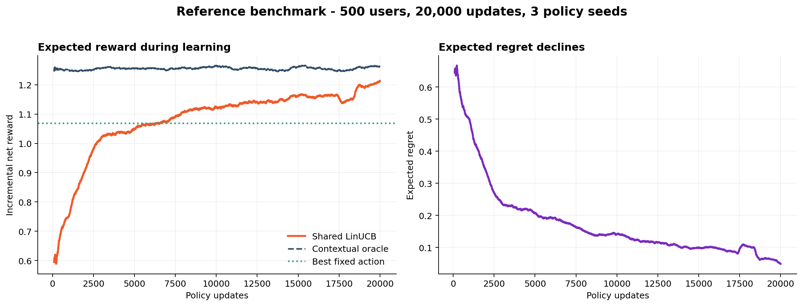
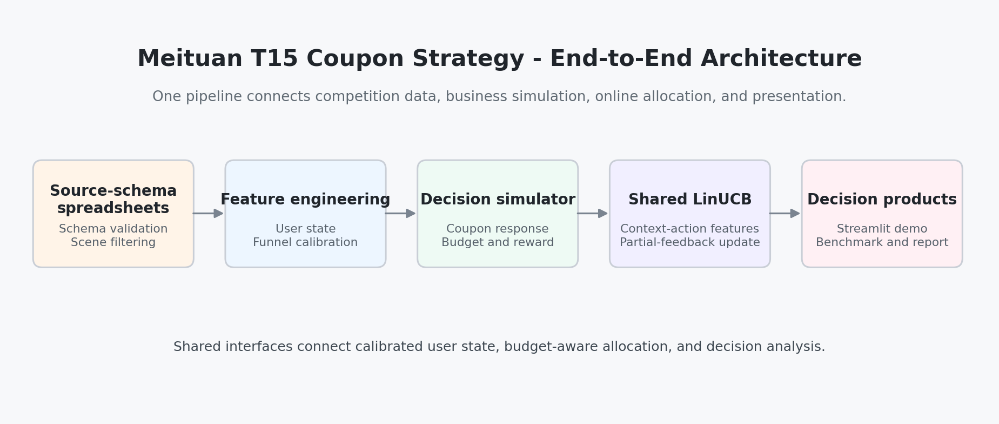
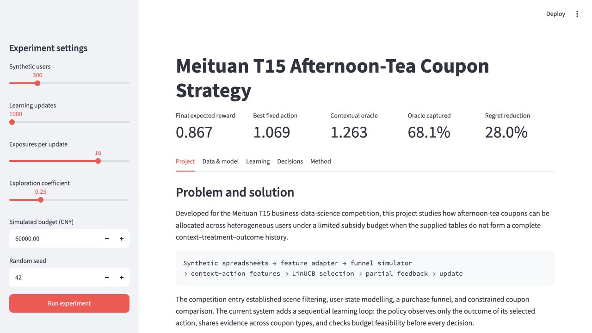

# Final Technical Report — Meituan T15 Afternoon-Tea Coupon Strategy

## Executive summary

This project addresses a campaign-design problem from the Meituan T15 business-data-science competition: how should afternoon-tea coupons be assigned across users with different basket values, activity levels, and price sensitivity when the campaign has a finite subsidy budget?

The solution covers scene extraction, user-state construction, purchase-funnel calibration, coupon-response simulation, sequential allocation, budget control, evaluation, and interactive presentation. The competition entry established the data and business workflow; subsequent engineering work introduced a shared LinUCB allocation layer that learns from selected-action outcomes.

In the reference experiment, shared LinUCB reached a mean final-window expected reward of 1.2131 across three policy seeds. The best fixed action scored 1.0688 and the contextual oracle scored 1.2560. The learned policy therefore exceeded the best single action by approximately 13.5%, captured 96.12% of oracle reward, and reduced expected regret by 90.00% from the first to the final reporting window.



## 1. Competition problem

Afternoon-tea promotion is not one decision repeated across all users. A high-value but price-insensitive user may purchase without a discount; a highly sensitive user may need a larger coupon; a low-basket user may receive little value from a coupon whose face value is large relative to the order. At the same time, repeatedly issuing the largest coupon can exhaust the campaign budget without maximizing incremental value.

The project therefore treats coupon strategy as a constrained sequence of decisions. At each update the system observes a user context, selects no coupon or one coupon from the catalog, receives a purchase outcome and incurred coupon cost, and updates its allocation model while preserving the remaining budget.

## 2. Input data and scene construction

The competition materials are represented by three source-schema tables:

- **User profiles:** demographic and behavioural attributes keyed by `user_id`.
- **Coupon-order records:** order value, coupon type, merchant category, product category, and order time.
- **Behaviour sequences:** view, click, cart, and purchase events.

`FeatureEngineering` validates these schemas and identifies the afternoon-tea scene by time window, business-unit keywords, point-of-interest categories, excluded meal and retail categories, and an order-value range. It then derives:

- the filtered user and order population;
- view → click, click → cart, and cart → purchase funnel probabilities;
- basket-value, activity, and price-sensitivity distributions;
- time-of-day factors and a coupon catalog;
- a reproducible campaign population for policy evaluation.

The repository generates deterministic input spreadsheets with the same schema so the complete input-to-decision workflow can run from committed fixtures.

## 3. System architecture



The project uses four domain layers and two delivery layers:

1. **Input adapter:** loads the source tables, filters the target scene, and derives calibration statistics.
2. **Campaign-state model:** generates heterogeneous user state and coupon metadata.
3. **Decision simulator:** turns user and coupon state into funnel probabilities, stochastic purchases, coupon cost, and expected reward.
4. **Allocation policy:** chooses an action, receives selected-action feedback, and updates online.
5. **Evaluation:** computes fixed and contextual references, regret, action mix, segment behaviour, and budget use.
6. **Presentation:** exposes the same pipeline through a CLI benchmark and an interactive Streamlit application.

`project_pipeline.py` is the orchestration layer shared by all entry points and connects feature engineering, simulation, allocation, and evaluation.

## 4. User, coupon, and funnel model

### 4.1 User state

Each generated user contains:

- expected basket value `V`;
- activity level `A`;
- posterior price-sensitivity parameters;
- exposure and success counts;
- an interpretable user segment.

Distribution selection considers empirical, rule-based, parametric, and mixture candidates. Diagnostics compare simulated and source distributions through quantile error, moments, and Kolmogorov–Smirnov distance. The application uses a fixed selection path for deterministic execution.

### 4.2 Coupon actions

The action set contains a no-coupon decision and candidate coupons. Coupon metadata records face value, whether the coupon is free, whether it expands basket value, an uplift assumption, and an attraction factor. These properties are used both by the simulator and by the contextual model.

### 4.3 Funnel response

`SimulationEngine` models purchase as a sequence of view, click, cart, and purchase stages. Coupon response can affect each stage, effective basket value, and expected coupon cost. User-coupon fit depends on user state and the coupon-to-basket relationship, allowing the preferred action to vary across users.

The simulator supports expected-value analysis, stochastic outcomes, individual coupon evaluation, and Monte Carlo comparison. It is therefore used by both the earlier coupon-strategy analysis and the current sequential policy.

## 5. Allocation method

### 5.1 Context-action representation

The shared model combines standardized user features, quadratic and pairwise user terms, coupon properties, and user-coupon interactions. One model can therefore transfer information across coupon types while learning that the same coupon behaves differently for different contexts.

### 5.2 Shared LinUCB

For each feasible action, shared LinUCB calculates an expected-reward estimate plus an uncertainty bonus controlled by `alpha`. The policy selects the highest upper confidence bound, observes only that action's stochastic response, and performs a ridge-regression update. A Sherman–Morrison rank-one update maintains the inverse covariance matrix without recomputing a full inverse after every decision.

A disjoint LinUCB implementation remains available as a diagnostic comparison. It maintains one model per action and helps verify that the shared representation, rather than the mechanics of LinUCB alone, provides cross-action learning.

### 5.3 Reward and budget

The maintained objective is incremental net value: simulated coupon GTV minus a coupon-cost penalty and an action-independent expected no-coupon baseline. Batched feedback over 16 exposures reduces update variance while retaining partial feedback. Before every decision, the policy excludes coupons whose face value exceeds the remaining budget; the history then records realized coupon cost and residual budget.

## 6. Application and decision presentation

The Streamlit application is the interactive form of the complete competition solution. It presents:

- competition objective and current architecture;
- source calibration and campaign settings;
- synthetic-user distribution and funnel probabilities;
- coupon catalog and action properties;
- rolling expected reward and regret;
- selected-action frequencies and budget consumption;
- segment-level action mix;
- recent decisions explained from their displayed inputs and outputs;
- the technical development from the competition entry to the maintained system.



Each explanation is generated from the displayed user state, selected action, expected reward, and regret.

## 7. Benchmark protocol

The reference benchmark runs:

```bash
python benchmark_contextual_bandit.py \
  --users 500 \
  --steps 20000 \
  --window 1000 \
  --seeds 3 \
  --alpha 0.25 \
  --feedback-batch-size 16 \
  --budget 120000
```

The user population is generated once with seed 42 and reused across policy seeds 0, 1, and 2. This isolates policy randomness from population changes. Evaluation uses a 1,000-update rolling window.

### Environment references

| Reference policy | Expected incremental net reward |
| --- | ---: |
| Random action | 0.5939 |
| Best fixed action | 1.0688 |
| Contextual oracle | 1.2560 |

### Learned policy

| Seed | Final-window expected reward | Final-window regret | Oracle capture |
| ---: | ---: | ---: | ---: |
| 0 | 1.2146 | 0.0467 | approximately 96% |
| 1 | 1.2137 | 0.0454 | approximately 96% |
| 2 | 1.2111 | 0.0548 | approximately 96% |

The standard deviation of final-window reward is 0.0018. The small spread across seeds indicates stable convergence under the reference configuration. The remaining gap to the contextual oracle is approximately 0.05 reward units per update.

## 8. Engineering development after the competition

| Competition version | Maintained version | Project-level effect |
| --- | --- | --- |
| Coupon strategies scored with full simulator access | Selected-action-only stochastic feedback | Converts allocation into a sequential learning problem |
| Separate coupon models and direct scoring | Shared context-action representation | Learns across coupons and personalizes by user state |
| Repeated matrix operations | Sherman–Morrison inverse updates | Reduces online update cost |
| Single simulated outcomes | Batched campaign feedback | Stabilizes the learning signal |
| Raw outcome value dominated by natural purchasing | Incremental-net reward | Aligns training with subsidy contribution |
| Local competition files | Deterministic public fixtures | Makes the complete workflow reproducible |
| Separate entry-point assembly | Shared `project_pipeline.py` | Keeps the CLI, benchmark, tests, and application on the same execution path |

## 9. Testing and reproducibility

The automated suite covers:

- deterministic fixture generation;
- missing-input behaviour and schema loading;
- complete feature-engineering and simulation flow;
- stochastic but seeded campaign feedback;
- selected-action-only policy updates;
- Sherman–Morrison inverse accuracy;
- contextual personalization;
- budget safety and invalid configuration;
- the complete public project pipeline and summary metrics.

GitHub Actions installs the declared dependencies and runs all tests for pushes and pull requests. The benchmark, asset generator, and Streamlit application call the same orchestration layer.

## 10. Evaluation and deployment requirements

The benchmark measures policy behaviour in the semi-synthetic campaign environment. The competition tables do not contain randomized treatment assignments, action propensities, or a unified context-action-outcome log, so they cannot identify live incremental coupon effects.

A production evaluation would add controlled exploration, known-propensity logging, delayed-conversion attribution, operational budget pacing, coupon-eligibility rules, safety monitoring, and inverse-propensity or doubly robust offline evaluation before an online experiment.
